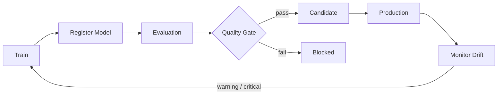

# ⚙️ MLOps Control Plane

**A MAK'MA Studio Product · MAK'MA Labs**

[Live Product Demo](https://maharshimak.github.io/makma-ai-os/projects/mlops-control-plane/) · [MAK'MA Labs](https://maharshimak.github.io/makma-ai-os/projects/)

A compact model lifecycle control plane for **registration, quality gates, promotion and drift monitoring**.


## Product contract — engineering upgrade

**Problem and audience:** A lifecycle policy workbench for ML engineers deciding whether model evidence supports rollout.

**Live tool:** https://maharshimak.github.io/makma-ai-os/projects/mlops-control-plane/

**Implemented browser workflow:** Candidate artifact metadata, multiple directional metric thresholds, baseline deltas, promotion gate, normalized PSI, production/candidate snapshots, canary and rollback decisions, traffic recommendation and fingerprinted governance JSON.

**Backend and parity contract:** Python CanarySnapshot now enforces integer requests, finite bounded probabilities and positive latency; rollout policies validate traffic and budgets. Browser mirrors core promotion/canary concepts and adds a combined orchestration gate: failed promotion or critical drift prevents advancement and rollback takes precedence.

**Architecture:** `makma-ai-os/demo` is the shared web product source and Pages deployment. This repository owns its Python domain package. The central `tests/e2e` suite exercises all nine products; `tests/fixtures/python-parity.json` plus `scripts/generate_parity.py` guard shared mathematical contracts. Backend revisions used for regeneration are pinned in the central `backend-lock.json`.

**Safety and limitations:** No infrastructure deployment or actual traffic changes. Model URI/fingerprint metadata and snapshots are user supplied. Manifest SHA-256 is reproducibility evidence, not a digital signature or verification of a remote artifact. Inputs are validated, rendered user values are escaped, and deterministic results are not presented as model inference.

**Verification:** Run `python -m ruff check .` and `python -m pytest -q`. `tests/test_engineering_upgrade.py` protects the new rejection/correctness paths. Central web checks: `npm ci`, `npm test`, `npm run build`, `npx playwright install --with-deps chromium`, `npm run test:e2e`. CI gates publishing on browser interactions and validates all public URLs after deployment.

**Lifecycle and deployment boundary:** model stages now follow an explicit one-way transition graph, and `HTTPDeploymentTarget` can carry bounded typed deploy/traffic/rollback commands to a configured infrastructure controller over HTTPS without embedding arbitrary shell execution in the policy engine.

**Highest-value next work:** Authenticated registry, signed artifacts and integration with a real rollout controller.

**Provenance:** Independent MAK’MA Studio engineering implementation; examples are synthetic and no employer code or data is included. Existing MIT license applies.


## Implemented

- model artifact registry
- SHA-256 dataset fingerprints
- evaluation records
- promotion policy
- stage transitions
- Population Stability Index (PSI)
- drift severity classification
- durable SQLite-backed model registry for API lifecycle state, plus standalone JSONL utilities
- immutable persisted lifecycle transition history for registration, candidate promotion, production promotion and archival
- FastAPI service
- tests
- Docker

## Lifecycle



## Why this project matters

The interesting part of production ML is not just training a model. Teams need to answer:

- Which dataset produced this artifact?
- Which metrics were used to approve it?
- Why was a model promoted?
- Which model is currently in production?
- What happens to the previous production version?
- Is the live data distribution drifting?

This project makes that lifecycle explicit and inspectable.

## Example

```python
from mlops_cp.models import Evaluation, ModelVersion
from mlops_cp.registry import ModelRegistry

registry = ModelRegistry()

registry.register(
    ModelVersion(
        name="churn",
        version="1.2.0",
        artifact_uri="s3://models/churn/1.2.0",
        dataset_fingerprint="sha256:...",
    )
)

registry.add_evaluation(
    "churn",
    "1.2.0",
    Evaluation(
        metric="roc_auc",
        value=0.91,
        threshold=0.85,
    ),
)

decision = registry.promote_candidate("churn", "1.2.0")

if decision.allowed:
    registry.promote_production("churn", "1.2.0")
```

## Roadmap

- MLflow adapter
- real artifact store
- approval workflow
- canary deployment policy
- shadow evaluation
- rollback history
- OpenTelemetry traces
- Prometheus metrics
- cloud deployment templates

## Governed promotion and audit log

`mlops_cp.governed.GovernanceService` wraps the registry with stricter, auditable promotion:

- **Candidate evidence** (`mlops_cp.evidence.CandidateEvidence`, schema `candidate-evidence.v1`): the hand-off format for a training pipeline such as `mlops-production-pipeline`. It carries `producer`, `model_name`, `model_version`, `artifact_uri`, `artifact_sha256`, `dataset_fingerprint` (64-hex SHA-256), `config_sha256` (optionally with the `config` object, whose canonical-JSON SHA-256 must match), `code_version` (commit SHA, tag or `unknown`; `unknown` produces a policy warning), `metrics` (unique names, finite values and thresholds, direction) and optional `submitted_by`. Unknown fields are rejected. Evidence rows are insert-only.
- **Pipeline export** (`mlops-candidate-evaluation.v1`, produced by `mlops-production-pipeline`'s `evaluate_candidate` operation): `evidence_from_pipeline_export` validates the document against a vendored copy of the pipeline's JSON Schema (`src/mlops_cp/schemas/candidate-evaluation.v1.schema.json`), checks that the `model_id` suffix equals the first 16 hex characters of `artifact_sha256`, and maps it explicitly:

  | Export field | Evidence field |
  | --- | --- |
  | `dataset_sha256` | `dataset_fingerprint` |
  | `config_sha256`, `artifact_sha256`, `code_version`, `run_record_sha256` | same names |
  | `model_id` | `pipeline_model_id` |
  | `metrics` | `observed_metrics` (informational; the export has no thresholds and none are invented) |
  | `gate` | `pipeline_gate`, plus one registry evaluation `pipeline_gate` = 1.0 if allowed else 0.0, threshold 1.0 |
  | (wrapper) `model_name`, `model_version`, `artifact_uri`, `submitted_by` | same names; `producer` = `mlops-production-pipeline` |

  A pipeline gate with `allowed: false` is recorded at registration and is a blocking promotion reason (`pipeline gate rejected candidate: ...`). `run_record_sha256` is stored but not re-verified, since the run record itself is not supplied.
- **Artifact integrity**: `verify_artifact` hashes artifact bytes (supplied inline, or read from a relative path confined to `MLOPS_CP_ARTIFACT_ROOT`; absolute paths, `..` traversal and escaping symlinks are refused) and compares them with the registered `artifact_sha256`. Every attempt, successful or not, is written to the audit log; the latest attempt decides.
- **Promotion policy** (`evaluate_promotion`) reports every failing reason at once: audit chain intact, promotable lifecycle stage, evidence recorded and consistent with the registry row, artifact verified, all evaluation gates passing plus any server-configured required metrics, no drift at or above the denial severity (PSI computed from supplied bin counts), and enough distinct approvals. If approvals are the only thing missing, the decision is `requires_approval`; otherwise `deny`. The policy is configured on the service (`MLOPS_CP_REQUIRED_APPROVALS`, default 1; `MLOPS_CP_REQUIRED_METRICS`, comma-separated), not by the request being judged.
- **Approvals**: one per approver per model, bound to the evidence digest; the evidence submitter cannot approve their own model. `POST /v1/governance/{name}/{version}/approvals` records one. The approver name is asserted by the caller; there is no per-user identity behind the shared bearer token.
- **Audit log** (`mlops_cp.audit.AuditLog`): append-only, hash-chained events. Each event stores `prev_hash` and a SHA-256 over its canonical JSON. `verify()` detects edited, inserted, deleted or reordered events; SQLite triggers additionally reject `UPDATE`/`DELETE`. Removing events from the end of the chain is only detected when the caller supplies a previously recorded head hash (`expected_head`). This is tamper evidence, not a signature: someone who can rewrite the whole database can recompute the chain.
- `promote_to_production` changes the registry stage only when the decision is `allow`, and records the promotion in the audit log. Nothing in this package deploys a model or changes live traffic.

## makma.v1 contract

`mlops_cp.contracts` implements the shared MAK'MA execution envelope (`contracts/makma.v1.schema.json`, vendored unchanged). Python callers use `run_operation(operation, payload, *, run_id=None, correlation_id=None)` and `capabilities()`; the API exposes `GET /v1/capabilities` and `POST /v1/ops/{operation}` behind the same auth as the other protected routes (`X-Run-Id` / `X-Correlation-Id` headers are optional). Every operation is rule-based, so `execution_mode` is always `deterministic_offline`.

| Operation | Input | `data` / status |
| --- | --- | --- |
| `register_candidate` | `candidate-evidence.v1` object, or `{pipeline_export, model_name, model_version, artifact_uri, submitted_by?}` | `model_key`, `stage`, `evidence_sha256`, claimed artifact digest, `artifact_verified: false`, evaluations, source format, pipeline gate and observed metrics, audit head. `CONFLICT` on duplicates; schema or integrity failures of a pipeline export are `INVALID_INPUT` with field locations. |
| `verify_artifact` | `model_name`, `model_version`, exactly one of `path` (relative to the artifact root) or `content_base64` (at most 8 MiB decoded) | `verified`, expected/actual SHA-256, size. Path mode without a configured root is `blocked` (`ARTIFACT_ROOT_NOT_CONFIGURED`); escaping paths are `ARTIFACT_ACCESS_DENIED`. |
| `evaluate_promotion` | `model_name`, `model_version`, optional `drift: [{feature, expected, actual}]` | Decision, reasons, warnings, per-check booleans, approvals, drift PSI. `ok` with `policy.decision=allow`; `pending_approval` with `requires_approval`; `blocked` with `PROMOTION_DENIED` and `deny`. Read-only. |
| `rollback_decision` | `telemetry` and/or `canary` (production/candidate snapshots, current traffic stage), optional rollback thresholds | `action` (`rollback`, `hold`, `continue`, `increase`, `promote`, `complete`), `rollback`, reasons, the underlying decisions, `deployment_executed: false`. Rollback from either source wins; insufficient telemetry holds. |
| `audit_log` | optional `model_name` + `model_version`, `limit` (at most 1000), optional `expected_head` | Chain verification result and the most recent events. |

Unknown operations return `UNKNOWN_OPERATION`; schema violations return `INVALID_INPUT` with field locations but without echoing input values; unexpected failures return `INTERNAL_ERROR` without internal details.

## Scope and limitations

The API registry is SQLite-backed by default and persists model versions, evaluations, current stages and lifecycle transition events across restart. Governance evidence, approvals and the audit log live in the same SQLite file. JSONL state, lineage and canary helpers remain separate utilities rather than deployment integrations. Artifact digests are verified only when `verify_artifact` is called with the bytes or a confined local path; remote URIs are not fetched, and there are no signatures. The original `POST /v1/models/{name}/{version}/candidate` and `/production` routes still apply only the basic evaluation gate; the governed policy is enforced by `GovernanceService.promote_to_production` and reported by `evaluate_promotion`. Registration from evidence and its evidence row are separate writes: a crash between them leaves a model without evidence, which the policy then denies. Library callers receive mutable model objects and are trusted. No external rollout controller or automated infrastructure rollback is implemented.

## Installation and development

Requires Python 3.12 or newer. Run from this project directory.

```bash
python -m venv .venv
source .venv/bin/activate
python -m pip install -e ".[dev]"
python -m ruff check .
python -m pytest -q
python -m pip wheel --no-deps . -w dist
```

On Windows, activate with `.venv\Scripts\Activate.ps1`.

## Library usage

```python
from mlops_cp.models import ModelVersion, Evaluation
from mlops_cp.registry import ModelRegistry
r = ModelRegistry()
r.register(ModelVersion("demo", "1", "local/model.json", "synthetic-fingerprint"))
r.add_evaluation("demo", "1", Evaluation("accuracy", 0.9, 0.8))
print(r.promote_candidate("demo", "1"))
r.promote_production("demo", "1")
print(r.get("demo", "1").stage)
```

## Configuration

Library use needs no credentials. The API stores state at `MLOPS_CP_DB_PATH` (default `./data/control-plane.db`) and accepts `MLOPS_CP_API_TOKEN` for authenticated remote access. Governance settings: `MLOPS_CP_REQUIRED_APPROVALS` (default `1`), `MLOPS_CP_REQUIRED_METRICS` (comma-separated, default none) and `MLOPS_CP_ARTIFACT_ROOT` (unset disables path-based artifact verification). `run_operation` without an explicit service uses `MLOPS_CP_GOVERNANCE_DB_PATH` (unset means in-memory).

## Service and API schema

```bash
python -m uvicorn mlops_cp.api:app --host 127.0.0.1 --port 8000
```

Interactive endpoint schemas are at `http://127.0.0.1:8000/docs`; machine-readable schemas are at `/openapi.json`. The API is local-only by default. Set `MLOPS_CP_API_TOKEN` to enable bearer-authenticated remote access; registry reads and all lifecycle mutations then require `Authorization: Bearer <token>`.

## Container

```bash
docker build -t mlops-control-plane .
docker run --rm -p 127.0.0.1:8000:8000 mlops-control-plane
```

## Repository structure

| Path | Purpose |
| --- | --- |
| `src/mlops_cp/` | Implementation |
| `tests/` | Offline unit and regression tests |
| `contracts/makma.v1.schema.json` | Shared MAK'MA execution envelope schema |
| `docs/DESIGN.md` | Architecture and trust boundaries |
| `.github/workflows/ci.yml` | Install, lint, tests, wheel and container build |
| `pyproject.toml` | Dependencies and package configuration |

## Next engineering work

Transactional multi-writer persistence; artifact signatures; per-user authenticated approvals; routing the legacy promotion routes through the governed policy; real deployment adapters. These are planned work, not current capabilities.

## Contributing and security

See [CONTRIBUTING.md](CONTRIBUTING.md) and [SECURITY.md](SECURITY.md). CI runs on every push and pull request through `.github/workflows/ci.yml`.

## License and provenance

[MIT](LICENSE), copyright 2026 Maharshi Patel. This public portfolio implementation is independent of employer systems and contains no confidential employer code or data. Examples and test fixtures are synthetic.
